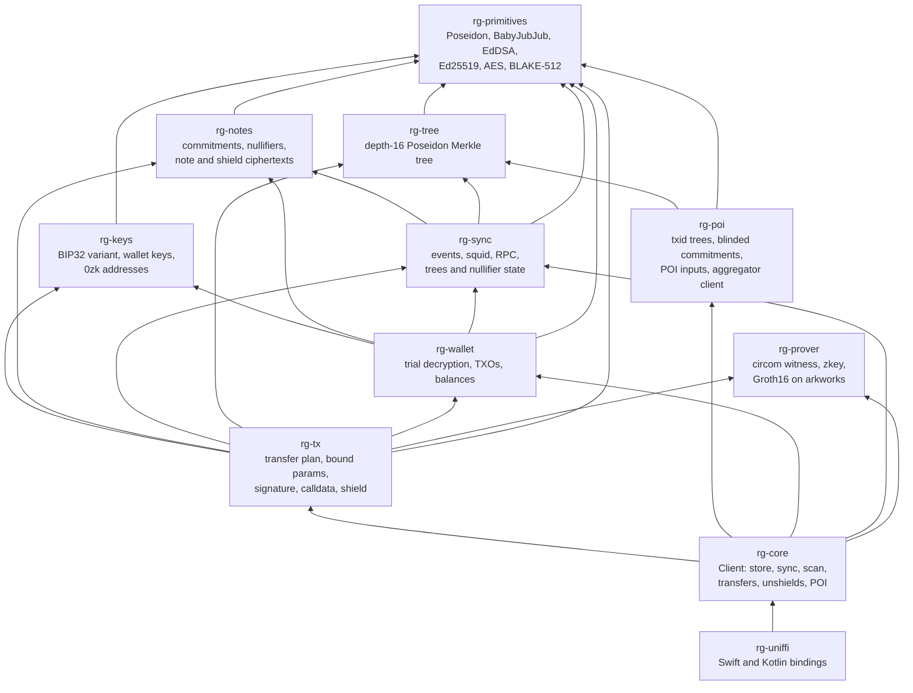
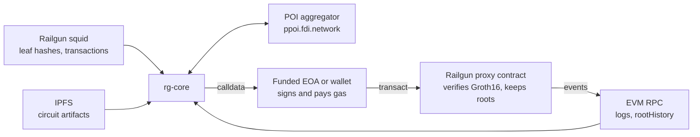
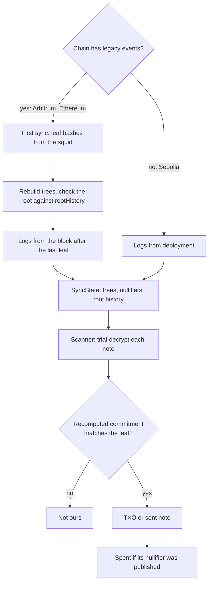
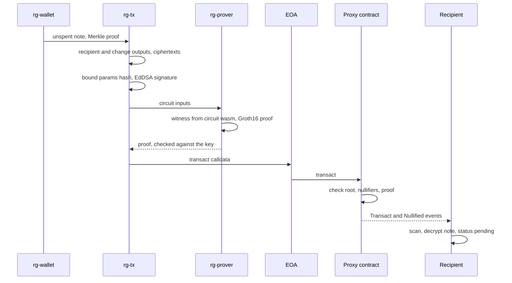
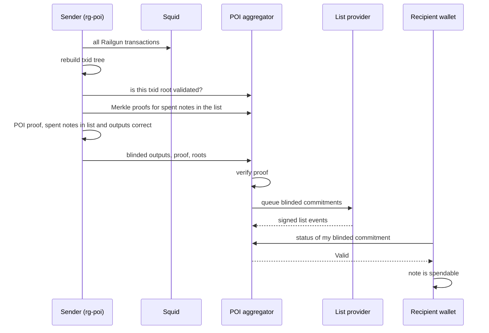

# Architecture

A Rust core for a private Railgun wallet, written to replace the TS SDK on mobile through
UniFFI. `rg-core` is the API, and `rg-uniffi` exposes it to Swift and Kotlin with no logic of its own.

## Crates

`rg-poi` stays independent of the wallet and prover: it builds circuit inputs, and `rg-core`
joins them. `rg-prover` knows nothing about Railgun
and takes named signals, which is why both the transfer and POI circuits run on it.

## External systems

Artifacts are downloaded when a circuit is first needed and hash-checked on every load.
`Client::send` signs an EIP-1559 transaction with an `EvmKey` and sends it. That account pays
gas and is public: it is derived on the standard path `m/44'/60'/0'/0/i` or loaded from a key,
and never from Railgun's spending or viewing keys. A broadcaster would hide it; there is none
yet. `UnsignedTx` stays available for any other wallet to send.

## Sync and scan

`Client::sync` refetches a reorg window each time. `FileStore` keeps the seed, logs and a
cursor, and `Client::open` replays them. Seeded leaves are hashes only, so a wallet's notes
must all come after the seed. A nullifier
hashes only the leaf position, so lookups are always scoped to a tree.

## A private transfer

An unshield is the same flow with one more output: a commitment whose npk is the public
address, last in the list, with no ciphertext and no tree position. The contract pays it
out, less its fee, and the POI proof carries the Railgun txid in place of a blinded note.

The contract never sees amounts, owners or the token of a private transfer. It learns that a
valid proof spent some unspent notes under a known root.

## POI

The contract does not enforce any of this; wallets and broadcasters do. Blinded commitments
are `poseidon(commitment, npk, global position)`, so the list holds no amounts or addresses.

POI artifacts are versioned apart from the engine, and the live aggregator rejects proofs
made with older keys. `docs/development.md` records the current IPFS root.

## Key material

The core never stores a key. `FileStore` holds chain data only, and a shell keeps the mnemonic in the iOS Keychain or behind the Android Keystore, device-only and unlocked-only, then builds a `Wallet` when it needs one.

| Secret | Handling |
| --- | --- |
| Spending and viewing keys | `PrivateKey`: not `Copy`, never printed, wiped on drop. Only `expose()` reads them. |
| `WalletKeys` | Not `Clone`, wiped on drop, and `Debug` shows only the master public key. `Wallet` drops it on Kotlin's `close()` or Swift's last release. |
| Seed, BIP32 nodes, BIP39 entropy and words | Wiped on drop. |
| `EvmKey`, the gas account | k256 `SigningKey`, wiped on drop, `Debug` shows only the address. |
| EdDSA and Ed25519 working values, including the signing nonce | Wiped when the call returns. |
| Mnemonic entering the core | `&[u8]` borrows the shell's own `Data` or direct `ByteBuffer`, with no UniFFI copy. The shell wipes that buffer after the call. |

What this does not cover:

- `generateMnemonic` returns through a UniFFI buffer that is freed without a wipe, and showing the words needs a platform string that cannot be wiped. Both happen once, at wallet creation.
- `nullifying_key` is copied into nullifiers, circuit inputs and the circom wasm memory. It reveals which notes are spent, not how to spend them.
- Per-note shared keys, decrypted notes and note randoms live as long as a scan result.
- HMAC, SHA-512, PBKDF2, AES and Poseidon internals, and moves of a value on the stack, are outside what `zeroize` can reach.
- Pages are not locked, so the OS may swap them or include them in a dump.

Wiping shortens how long a secret sits in memory. It does not protect a compromised process.
