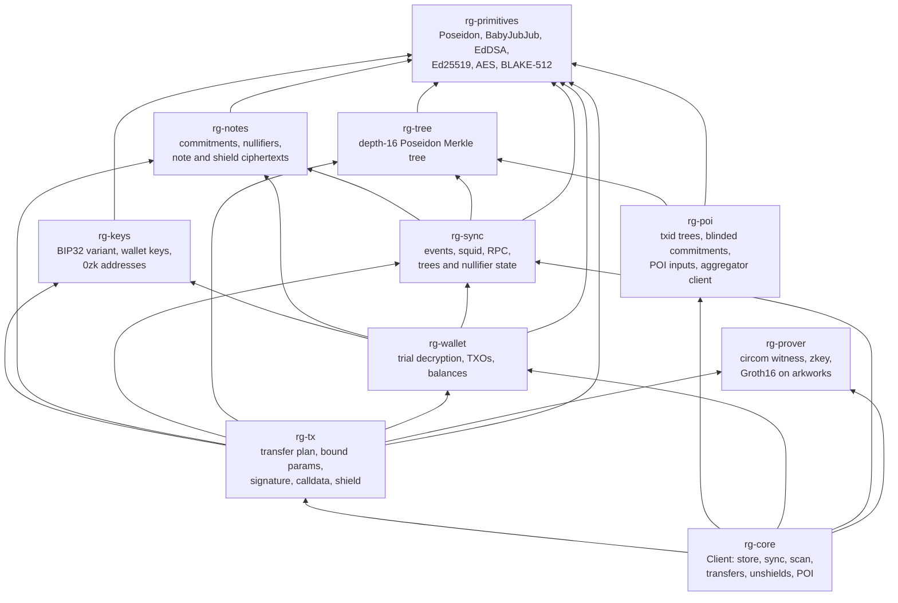
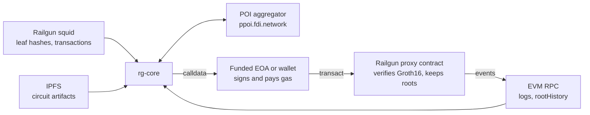
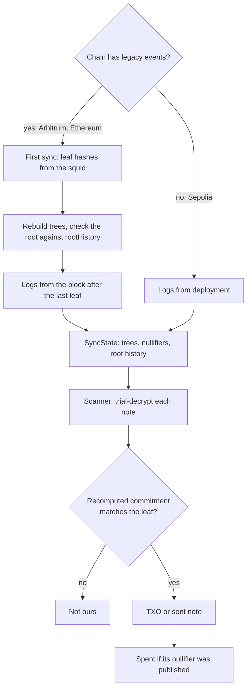
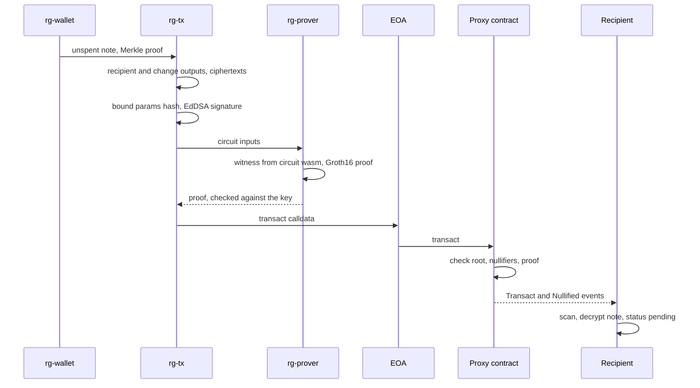
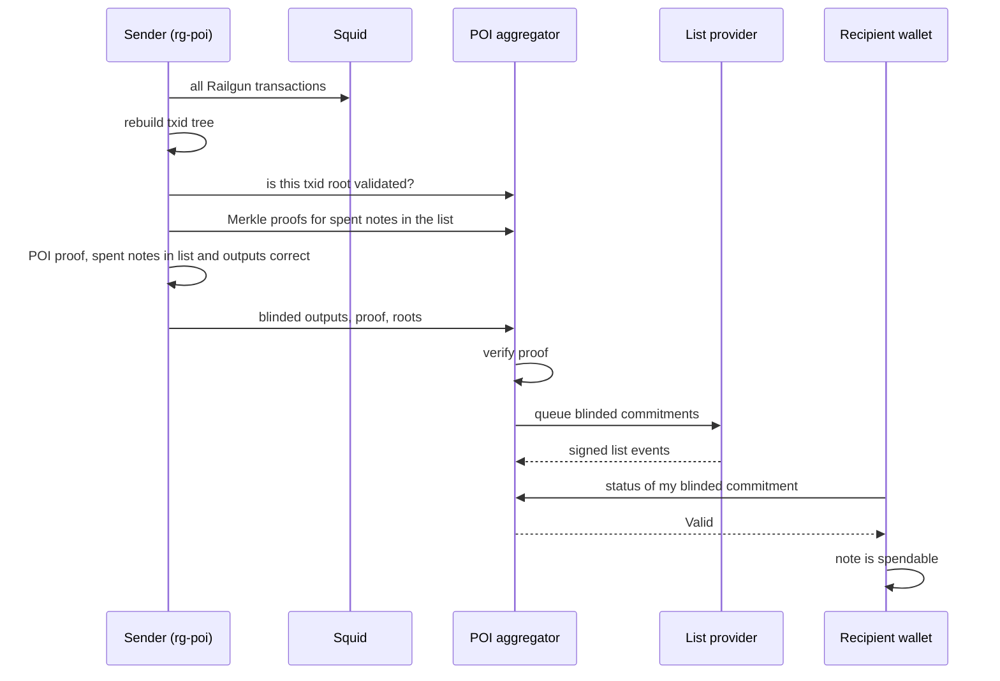

# Architecture

A Rust core for a private Railgun wallet, written to replace the TS SDK on mobile through
UniFFI. `rg-core` is the API those bindings will sit on; the FFI layer itself is not
written yet (see "Open items" in `HANDOFF.md`).

## Crates

`rg-poi` stays independent of the wallet and prover: it builds circuit inputs, and `rg-core`
joins them. `rg-prover` knows nothing about Railgun
and takes named signals, which is why both the transfer and POI circuits run on it.

## External systems

The core never signs EVM transactions. It prints calldata, and `harness/send.js` or any
wallet sends it.

## Sync and scan

`Client::sync` refetches a reorg window each time. `FileStore` keeps the seed, logs and a
cursor, and `Client::open` replays them. Seeded leaves are hashes only, so a wallet's notes
must all come after the seed. A nullifier
hashes only the leaf position, so lookups are always scoped to a tree.

## A private transfer

An unshield is the same flow with one more output: a commitment whose npk is the public
address, last in the list, with no ciphertext and no tree position. The contract pays it
out, less its fee, and the POI proof carries the Railgun txid in place of a blinded note.

The contract never sees amounts, owners or the token of a private transfer. It learns that a
valid proof spent some unspent notes under a known root.

## POI

The contract does not enforce any of this; wallets and broadcasters do. Blinded commitments
are `poseidon(commitment, npk, global position)`, so the list holds no amounts or addresses.

POI artifacts are versioned apart from the engine, and the live aggregator rejects proofs
made with older keys. `HANDOFF.md` records the current IPFS root.
